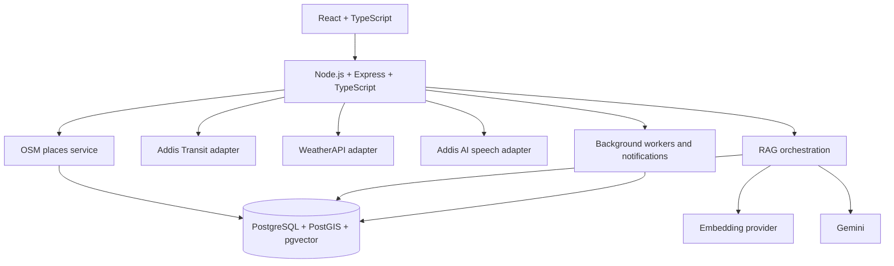

# GuzoMate — Software Requirements Specification (SRS)

**Version:** 2.0  
**Project:** GuzoMate — Travelers Assistance  
**Last updated:** 2026-10-22

## 1. Introduction

### 1.1 Purpose
GuzoMate is a multilingual travel-assistance application for discovering nearby services, exploring routes, checking destination weather, saving places, and reporting road incidents. Gemini with retrieval-augmented generation (RAG) provides grounded travel guidance, initially targeting Amharic, Afaan Oromo, and English.

This document is the proposed requirements baseline. Confirm each external provider's current official API documentation and terms before implementation.

### 1.2 Goals
- Find nearby hotels, restaurants, hospitals, pharmacies, mechanics, fuel stations, and other mapped services.
- Support travel questions and answers in English, Amharic, and Afaan Oromo.
- Request supported route information through Addis Transit.
- Show current weather and forecasts from WeatherAPI, including arrival-time suggestions.
- Support saved places and user preferences.
- Accept road incident reports and notify relevant nearby or route-affected travelers.
- Clearly distinguish mapped facts, forecasts, and unverified community reports.

### 1.3 Scope
**Included:** responsive web app; multilingual Gemini + RAG assistant; OSM maps/places; Addis Transit routing adapter; WeatherAPI integration; Addis AI speech adapter; PostgreSQL + PostGIS + pgvector; incident reporting/moderation/nearby search/notifications; saved places; authentication; Motion animations.

**Not assumed until provider documentation confirms it:** specific Addis Transit route modes, fares, timetables, live vehicle feeds, or navigation features; specific Addis AI transcription/synthesis capabilities or language coverage; official emergency dispatch; completeness of OSM or community reports.

### 1.4 User roles
- **Guest:** permitted public search, map, weather, and assistant features.
- **Registered traveler:** saved places, incident submissions, preferences, notifications.
- **Moderator/admin:** review reports and manage status.
- **Operator:** provider configuration, monitoring, retention, and deployment.

## 2. Technology stack

| Layer | Technology/provider | Responsibility |
|---|---|---|
| Maps and place data | OpenStreetMap (OSM) | Mapped places, map data, attribution/ODbL compliance |
| Routing | Addis Transit | Routing integration through an adapter; capabilities to be verified |
| AI assistant | Gemini + RAG | Intent interpretation and evidence-grounded responses |
| Weather | WeatherAPI | Current conditions, forecasts, provider-supported alerts |
| Speech | Addis AI | Supported speech functions; verify official API and languages |
| Database | PostgreSQL + PostGIS + pgvector | Relational data, geospatial queries, vector retrieval |
| Backend | Node.js + Express + TypeScript | REST API, orchestration, validation, authentication |
| Frontend | React + TypeScript | Responsive user interface |
| Animation | Motion | UI transitions and interaction feedback |

### Supporting implementation decisions
- Use server-side schema validation (for example, Zod).
- Use an ORM/query layer compatible with PostGIS and pgvector; use explicit SQL for advanced spatial/vector queries when necessary.
- Use background workers for notifications, incident expiry, and scheduled data refreshes.
- Select a push-notification provider during deployment.
- Evaluate a multilingual embedding model on real Amharic, Afaan Oromo, and English examples. Generation and embedding are separate concerns.
- Keep all provider secrets server-side.

## 3. System architecture

1. **React client:** map, places, routes, weather, assistant, speech controls, saved places, incident reporting.
2. **Express API:** authentication, validation, rate limits, application services, provider orchestration.
3. **Provider adapters:** OSM data import/query, Addis Transit, WeatherAPI, Addis AI, Gemini, and embedding model.
4. **Retrieval layer:** SQL/PostGIS filters, optional pgvector retrieval, ranking, context construction.
5. **PostgreSQL:** users, places, incidents, confirmations, saved places, subscriptions, weather cache, RAG documents/embeddings.
6. **Workers:** notifications, expiry, cache refresh, and OSM refresh/import.

### Core retrieval rule
- Nearby places/incidents: SQL + PostGIS first.
- Semantic matching of descriptions/travel knowledge: pgvector when useful.
- Weather: fresh WeatherAPI data or a cache within its configured TTL.
- Routes: Addis Transit adapter.
- Answers: Gemini receives timestamped, source-labelled evidence and must not invent missing details.



## 4. Functional requirements

### FR-01 Language
- Support English, Amharic, and Afaan Oromo where translations and model quality permit.
- Let users choose a preferred response language.
- Detect the query language when no preference is available.
- Preserve proper names, coordinates, and measurements.

### FR-02 Nearby places
- Display places sourced from OSM.
- Filter by category, radius, and available tags.
- Return name, category, coordinates, distance, address/tags when present.
- Never fabricate opening hours, prices, ratings, accessibility, safety, or availability.
- Display `© OpenStreetMap contributors` and link to `https://www.openstreetmap.org/copyright`.

### FR-03 Maps and routes
- Display place and incident markers.
- Request supported routes through the Addis Transit adapter.
- Normalize provider output to an internal route format.
- Return clear errors/limitations when routing is unavailable.
- Do not claim support for a mode, fare, timetable, live status, or turn-by-turn navigation unless verified.

### FR-04 Weather and arrival advice
- Retrieve current weather and forecasts from WeatherAPI.
- Accept current coordinates or a destination.
- Provide arrival-time advice only when suitable forecast data is available.
- Derive suggestions from actual fields, e.g. rain probability may support an umbrella suggestion.
- Return source and retrieval timestamp.
- Cache with configurable TTL; label stale data or refresh it.

### FR-05 Gemini + RAG
- Accept queries in supported languages.
- Identify intent: places, routing, weather, incidents, or mixed requests.
- Retrieve structured facts before generating an answer.
- Apply PostGIS geographic filters before semantic ranking.
- Use pgvector for useful semantic matching of descriptions and curated travel knowledge.
- Pass source-labelled context to Gemini.
- Distinguish facts, forecasts, and unverified user reports.
- Disclose missing/conflicting evidence rather than guessing.

### FR-06 Speech
- Expose speech features only after Addis AI's supported operations, languages, formats, authentication, quotas, and retention terms are verified.
- Proxy calls through the backend; never expose credentials to the browser.
- Provide text interaction as a fallback.
- Handle permission denial, unsupported language, timeout, and provider failures.

### FR-07 Saved places
- Authenticated users can save, list, and remove places.
- Store a normalized place ID or stable OSM type/ID reference.
- Show a place as unavailable if its source record disappears; do not silently substitute another place.

### FR-08 Incident reporting
- Authenticated users can submit type, location, description, and optional evidence if secure uploads are implemented.
- Validate coordinates, type, input length, and request rate.
- New reports begin as `PENDING` / unverified.
- Support `PENDING`, `ACTIVE`, `RESOLVED`, `REJECTED`, and `EXPIRED`.
- Detect likely duplicates and allow authorized moderation.
- Show report age and verification status.
- Expire or re-evaluate reports using configurable, type-specific rules.

### FR-09 Incidents and notifications
- Retrieve incidents near a point or route corridor.
- Let users configure notification types and radius.
- Notify relevant users through a configured push provider.
- Deduplicate and rate-limit notifications.
- Do not disclose reporter details or present community reports as official emergency information.

### FR-10 Moderation
- Authorized moderators can activate, reject, resolve, or expire reports.
- Audit every status change with actor, timestamp, action, and reason.
- Protect moderation endpoints with role-based authorization.

## 5. Non-functional requirements

### Security
- Enforce authentication and role-based access control.
- Validate all inputs on the server; use HTTPS in production.
- Rate-limit authentication, AI, speech, incident submission, and provider proxy routes.
- Store provider credentials in environment/managed secrets, never frontend bundles.
- Use least-privilege database credentials.
- Sanitize user content and validate uploaded files if uploads are supported.

### Privacy
- Request location only when needed and explain its purpose.
- Minimize location and personal data retention.
- Do not store raw speech recordings by default unless required and disclosed.
- Provide appropriate data deletion mechanisms.

### Reliability and performance
- Use provider timeouts, bounded retries/backoff, and circuit-breaker behavior.
- Cache suitable responses while respecting provider terms and freshness.
- Do not blindly retry non-idempotent incident submissions; support idempotency keys.
- Index PostGIS geography columns; add vector indexes when justified by data volume.
- Keep provider calls outside long-running database transactions.
- Establish latency targets after hosting and baseline tests are selected.

### Accessibility and usability
- Responsive mobile/desktop layouts.
- Keyboard navigation, visible focus, semantic controls, and accessible labels.
- Respect reduced-motion preferences.
- Do not convey safety status through animation/color alone.

### Data quality
- Preserve OSM source IDs and attribution.
- Record source and retrieval timestamps.
- Do not invent missing place fields or unsupported provider capabilities.
- Clearly show incident age and verification level.

## 6. Proposed data model

### User
`id UUID`, `email nullable/unique`, `passwordHash or external identity`, `preferredLanguage` (`en`, `am`, `om`), `role` (`USER`, `MODERATOR`, `ADMIN`), `createdAt`, `updatedAt`.

### Place
`id UUID`, `osmType` (`node`, `way`, `relation`), `osmId`, `name nullable`, `category`, `tags JSONB`, `address nullable`, `location geography(Point,4326)`, `sourceUpdatedAt nullable`. Unique `(osmType, osmId)`.

### SavedPlace
`userId`, `placeId`, `createdAt`. Unique `(userId, placeId)`.

### Incident
`id`, `reporterId`, `type`, `description`, `location geography(Point,4326)`, `status`, `severity`, `occurredAt`, `createdAt`, `updatedAt`, `expiresAt`, optional `evidenceUrl`.

### IncidentConfirmation
`id`, `incidentId`, `userId`, `confirmationType`, `createdAt`. Prevent repeated identical confirmation by one user.

### NotificationSubscription
`id`, `userId`, `enabled`, `radiusMeters`, `incidentTypes`, timestamps. Use a separate device/token table when multiple devices are supported.

### WeatherCache
`id`, coordinate/geohash or cache key, `provider`, `forecastJson JSONB`, `retrievedAt`, `validUntil`.

### RagDocument
`id`, `sourceType`, `sourceId`, `language nullable`, `content`, `metadata JSONB`, `embedding`, timestamps. Keep model/version and vector dimension consistent within an indexed collection.

### AuditLog
`id`, `actorUserId`, `action`, `targetType`, `targetId`, `reason nullable`, `createdAt`, safe metadata.

## 7. Multilingual RAG pipeline
1. Parse query into intent, language, location, category, time, and preferences.
2. Resolve/validate target coordinates.
3. Apply PostGIS filters for local places/incidents.
4. Optionally retrieve semantic descriptions/travel documents using pgvector.
5. Build compact context with source, timestamp, distance, status, and relevant fields.
6. Ask Gemini to answer in the requested language using only supplied evidence.
7. Validate output and disclose uncertainty.
8. Fetch live weather/incident status at request time; do not rely on stale embeddings for dynamic facts.
9. Evaluate English, Amharic, and Afaan Oromo retrieval separately with labelled test queries.

## 8. Provider integration requirements

### OSM
Use a regional extract or suitable query service during prototyping; normalize nodes, ways, and relations. Do not treat public Overpass as an unlimited production backend. Comply with attribution and ODbL.

### Addis Transit
Implement a `RoutingProvider` adapter. Verify official base URL, authentication, coverage, route modes, live data, quotas, attribution, caching rules, and error contract before coding provider-specific behavior.

### Gemini
Implement an `LlmProvider`. Use schema-constrained output where available, token/cost limits, timeouts, and prompt-injection defenses for user and retrieved content.

### WeatherAPI
Keep the API key server-side. Normalize units/timestamps, cache forecasts with TTL, and verify plan quotas and commercial terms.

### Addis AI
Implement a `SpeechProvider` only after confirming official API, supported operations and languages (including Amharic/Afaan Oromo), formats, authentication, quotas, and retention terms.

## 9. API conventions
- Base path: `/api/v1`.
- JSON by default; multipart/binary only for documented media endpoints.
- ISO 8601 timestamps with timezone.
- Latitude `[-90,90]`, longitude `[-180,180]`.
- Meters and Celsius internally.
- Standard error:
```json
{
  "error": {
    "code": "VALIDATION_ERROR",
    "message": "One or more fields are invalid.",
    "details": []
  }
}
```
- Paginate collections; protect user and moderator endpoints.
- See `GuzoMate_API_Reference.md` for endpoint contracts.

## 10. Frontend
- React + TypeScript with feature-based modules.
- Main views: map/nearby services, routes, weather, incident map/list, assistant, saved places, preferences.
- Motion for restrained transitions, loading feedback, and panel animations.
- Respect reduced-motion settings.
- Keep provider secrets out of the client.

## 11. Testing and acceptance criteria

### Acceptance
- Nearby mapped services return accurate distances and OSM attribution.
- Route calls use the Addis Transit adapter and degrade gracefully.
- Weather responses show source/retrieval time; arrival advice uses a suitable forecast.
- Assistant answers in requested supported language and does not invent place facts.
- Saved places can be created/listed/deleted by their owner.
- Reports are validated, initially unverified, discoverable geographically, and status-labelled.
- Eligible users receive non-duplicated incident notifications.
- Speech is enabled only for confirmed Addis AI capabilities.
- Unauthorized users cannot moderate incidents.

### Testing
- Unit: validation, adapters, language routing, ranking, incident state transitions.
- Integration: PostGIS radius queries, ownership checks, incident search.
- Contract tests with mocked external providers.
- E2E traveler journeys.
- Security tests: authorization, injection, rate limits, upload safety, data exposure.
- Multilingual retrieval set and answer-language checks.
- Accessibility, reduced-motion, and responsive UI tests.

## 12. Implementation sequence
1. Repo setup, auth, environment, migrations, API conventions.
2. OSM normalization/import and PostGIS nearby search.
3. Addis Transit adapter after provider contract verification.
4. WeatherAPI adapter, cache, arrival advice.
5. Incident reports, moderation, nearby search, expiry, notifications.
6. Gemini RAG and pgvector with multilingual evaluation.
7. Addis AI speech adapter after verification.
8. Saved places, Motion UI, accessibility, observability, deployment hardening.

## 13. Risks and mitigations

| Risk | Mitigation |
|---|---|
| Addis Transit/Addis AI contracts unclear | Verify docs and isolate behind adapters |
| Uneven Amharic/Oromo retrieval | Labelled benchmark; compare models with real queries |
| Missing/outdated OSM data | Show available fields, refresh, never fabricate |
| Weather/provider outage | Cache with freshness metadata and clear unavailable state |
| False incident reports | Pending status, moderation, corroboration, expiry, visible age |
| AI hallucination | Ground in structured data and disclose uncertainty |
| Cost/quota limits | Cache, rate-limit, monitor, set budgets |

## 14. Licensing and terms
Attribute OSM with `© OpenStreetMap contributors` and link `https://www.openstreetmap.org/copyright`. Review ODbL obligations. Verify commercial terms, quotas, attribution, caching, and retention policies for Addis Transit, Addis AI, Gemini, and WeatherAPI before launch.

---
**End of SRS**
