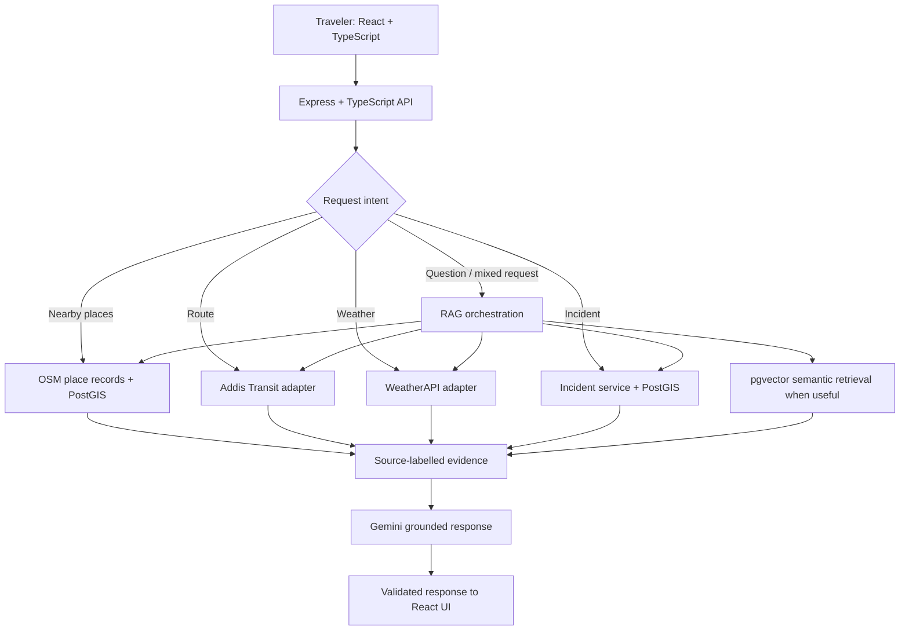
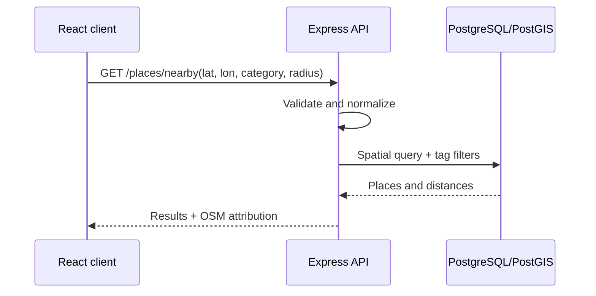
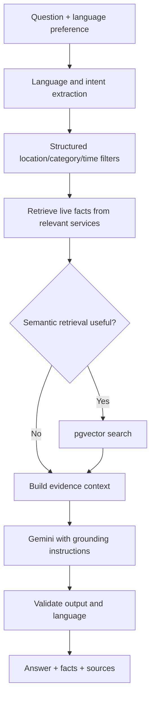
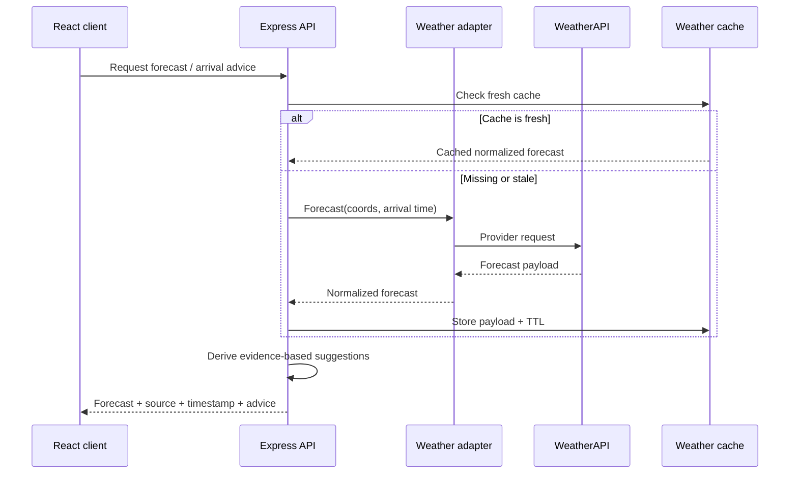
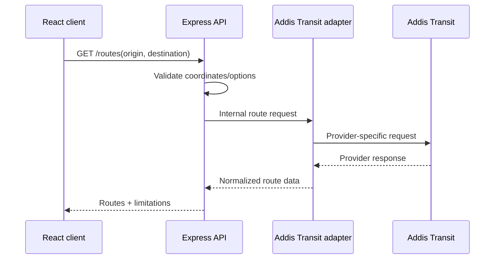
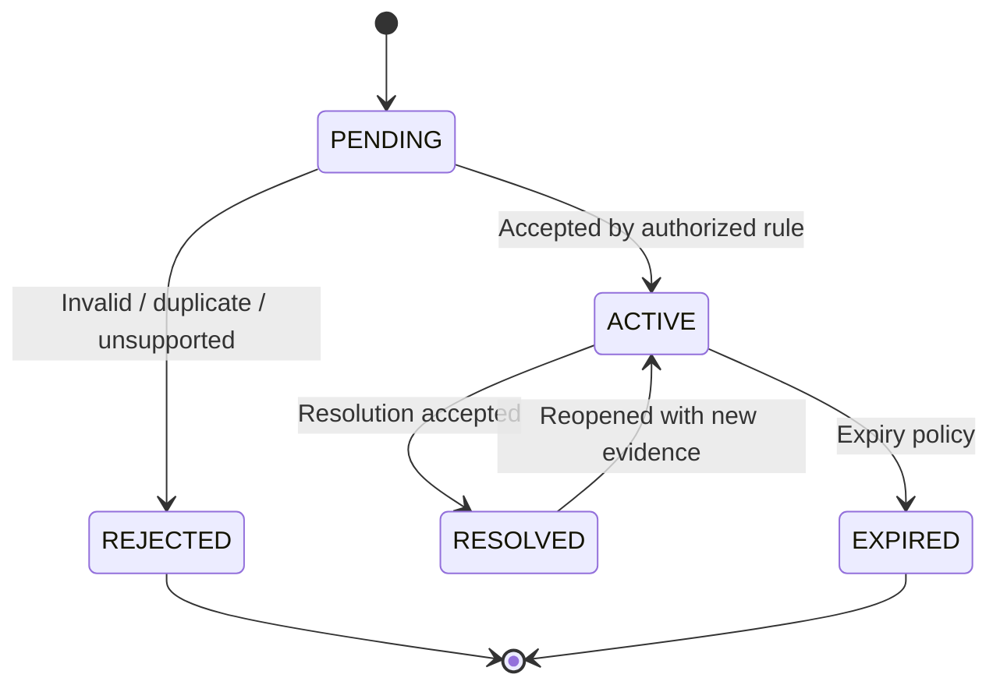
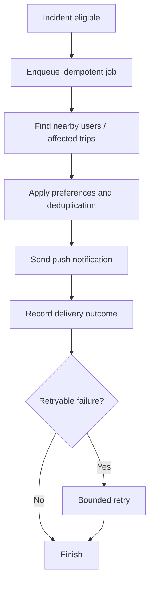

# GuzoMate — System Workflow

**Version:** 2.0  
**Last updated:** 2026-10-22

This document describes end-to-end workflows for GuzoMate's selected stack:

- **Maps:** OpenStreetMap (OSM)
- **Routing:** Addis Transit
- **AI:** Gemini + RAG
- **Weather:** WeatherAPI
- **Speech:** Addis AI
- **Database:** PostgreSQL + PostGIS + pgvector
- **Backend:** Node.js + Express + TypeScript
- **Frontend:** React + TypeScript
- **Animation:** Motion

Provider-specific capabilities must be verified against official documentation before implementation. Do not infer unsupported route or speech capabilities from a provider's name.

## 1. High-level workflow

## 2. Workflow A — Nearby places

1. User grants location access or chooses a destination.
2. Frontend calls `GET /api/v1/places/nearby` with coordinates, category, radius, and optional query.
3. Backend validates coordinates, radius, category, and pagination.
4. Place service searches normalized OSM records using PostGIS and OSM tags.
5. Backend returns matching records and computed distances.
6. Frontend displays markers/list results with OSM attribution.
7. If the user asks for a semantic preference (e.g. “somewhere peaceful”), the assistant may rank available descriptions with pgvector, but geographic/category filtering remains first.

## 3. Workflow B — Multilingual Gemini + RAG

### Online request
1. User submits a question and optional coordinates, arrival time, and preferred language.
2. Backend resolves language from explicit preference, user settings, or language detection.
3. Intent parser extracts categories, constraints, destination, time, and requested action.
4. Orchestrator fetches relevant structured facts:
   - OSM/PostGIS for nearby places.
   - Addis Transit adapter for route requests.
   - WeatherAPI for weather/forecast.
   - Incident database for active/recent reports.
5. If semantic ranking is useful, embed the query and retrieve relevant text from pgvector.
6. Build a compact context with source, timestamp, distance, incident verification status, and uncertainty.
7. Send the context to Gemini with instructions to answer in the requested language and not invent missing facts.
8. Validate the response and attach source metadata/limitations.
9. Return answer plus structured results to the frontend.

### Data preparation and indexing
1. Import or refresh a regional OSM extract.
2. Normalize OSM nodes, ways, and relations into place records.
3. Keep coordinates, categories, and tags in structured/PostGIS fields.
4. Prepare embeddings only for useful descriptions and curated travel documents.
5. Store embedding model/version metadata; re-embed if the model or vector dimension changes.
6. Do not use embeddings as the sole source for live weather or incident status.

### RAG grounding rules
- Geographic constraints are enforced by PostGIS, not vector similarity alone.
- Never invent price, rating, hours, accessibility, safety, or availability.
- Label community incident reports as unverified until their status changes through authorized rules.
- Use live or acceptably fresh provider data for weather and routes.
- Keep source/retrieval timestamps with evidence.
- Treat user content and retrieved documents as untrusted data; ignore instructions embedded inside them.

## 4. Workflow C — Weather and arrival advice

1. User selects a destination and arrival time.
2. Backend validates coordinates, timestamp/timezone, and forecast horizon.
3. Weather adapter checks a fresh cache; if missing/stale, it calls WeatherAPI.
4. Adapter normalizes provider fields, units, timestamps, and missing values.
5. Advice service maps actual forecast fields to suggestions (e.g. chance of rain may support an umbrella suggestion).
6. If natural-language explanation is needed, Gemini explains the forecast using the returned values as evidence.
7. API returns forecast, source, retrieval time, and limitations.
8. UI labels stale or unavailable forecast data.

If the requested arrival time is outside the provider's forecast horizon, explain that a reliable forecast is unavailable; do not extrapolate unsupported values.

## 5. Workflow D — Routing through Addis Transit

1. User selects origin and destination or shares location.
2. Frontend sends coordinates and optional route preference to the backend.
3. Backend validates the request.
4. Addis Transit adapter maps the internal request to the verified provider schema.
5. Adapter normalizes the provider response.
6. Backend returns only fields actually supplied by the provider.
7. UI shows limitations if the service is unavailable or a requested feature is unsupported.

Do not assume transit modes, fares, timetables, live vehicle positions, or turn-by-turn navigation until the provider's documentation confirms them.

## 6. Workflow E — Speech through Addis AI

This workflow is conditional on Addis AI supporting the required operation and language.

1. User taps microphone or speak-aloud control.
2. Browser/device requests microphone permission if recording is required.
3. Frontend uploads audio to GuzoMate backend, not directly to Addis AI.
4. Backend validates MIME type, size, duration, authentication, and rate limits.
5. Speech adapter calls the verified Addis AI endpoint.
6. Backend returns a transcription or generated audio in the documented format.
7. For speech-to-text, transcription text enters the normal multilingual RAG workflow.
8. If speech is unsupported or fails, keep text interaction available and show a clear message.
9. Avoid logging raw audio; define retention and deletion rules.

## 7. Workflow F — Submit and moderate a road incident

1. Authenticated traveler submits incident type, location, description, and optional evidence.
2. Backend validates input and applies rate limits.
3. Duplicate detection searches for recent nearby reports of a similar type.
4. Backend creates a `PENDING` / `UNVERIFIED` report.
5. Client receives report ID and current status.
6. Moderation or corroboration rules may change the status.
7. Each status change is audited.
8. Active reports appear in nearby search with age and verification level.
9. An expiry worker re-evaluates old reports and marks them expired when policy requires.

A normal user's resolution signal should not automatically change canonical status unless policy explicitly authorizes it.

## 8. Workflow G — Notify travelers near or approaching an incident

1. Incident becomes eligible for notification.
2. Backend creates an idempotent notification job.
3. Worker queries notification subscriptions and relevant active trips using PostGIS. Route-corridor matching is preferred over broad-radius matching when route data is available.
4. Worker filters by radius, type, user preference, recency, and previous delivery.
5. Push provider sends a concise alert with report age and verification status.
6. Delivery outcome is recorded; retries use bounded backoff.
7. Duplicate notifications are suppressed and users can disable alerts.

Do not disclose reporter identity or imply that a community report is official emergency information.

## 9. Workflow H — Save a place

1. User taps Save on a place.
2. Frontend calls `POST /api/v1/saved-places` with normalized place ID.
3. Backend authenticates the user and checks the place exists.
4. Database inserts a unique `(userId, placeId)` association.
5. UI updates saved state.
6. To unsave, call `DELETE /api/v1/saved-places/:placeId`; delete only the current user's association.

## 10. Motion in the frontend

Use Motion for short transitions between panels/messages, loading feedback, map drawer transitions, incident status feedback, and saved-place confirmation.

Requirements:
- Respect `prefers-reduced-motion`.
- Never delay safety-critical incident information for an animation.
- Include text/icons so status is not conveyed by animation or color alone.
- Keep controls keyboard accessible with visible focus.

## 11. Failure and fallback workflow

| Failure | Expected behavior |
|---|---|
| OSM query/import unavailable | Use local normalized data if available; otherwise show service unavailable |
| Addis Transit unavailable | Do not fabricate routes; disclose route service unavailability |
| WeatherAPI timeout/quota | Use cache only if freshness is acceptable and label its age; otherwise show unavailable |
| Gemini failure | Return structured results without AI prose where possible |
| pgvector failure | Fall back to structured SQL/PostGIS retrieval |
| Addis AI unsupported language/operation | Keep text input/output available |
| Push provider failure | Retry asynchronously with bounded backoff; don't block incident submission |
| Stale incident | Display age/verification and apply expiry policy |

## 12. Observability and audit
Record request ID, endpoint latency, status code, provider outcomes, RAG retrieval metrics, language-specific evaluation results, incident status transitions, notification delivery/retry metrics, and moderation actions.

Do not log secrets, passwords, raw audio, or unnecessary precise location history. Restrict audit-log access and define retention.

## 13. Deployment checklist
- Enable PostGIS and pgvector in PostgreSQL.
- Configure Gemini credentials and the selected embedding model.
- Configure WeatherAPI key, quotas, and cache TTL.
- Obtain/verify Addis Transit API documentation and credentials, if required.
- Obtain/verify Addis AI API documentation, supported languages, and credentials.
- Configure OSM ingestion, attribution, update strategy, and ODbL compliance.
- Configure push provider and background worker.
- Configure HTTPS, CORS, rate limits, health checks, monitoring, and secret storage.
- Run migrations, integration tests, multilingual retrieval tests, and incident workflow tests.

---
**End of System Workflow**
