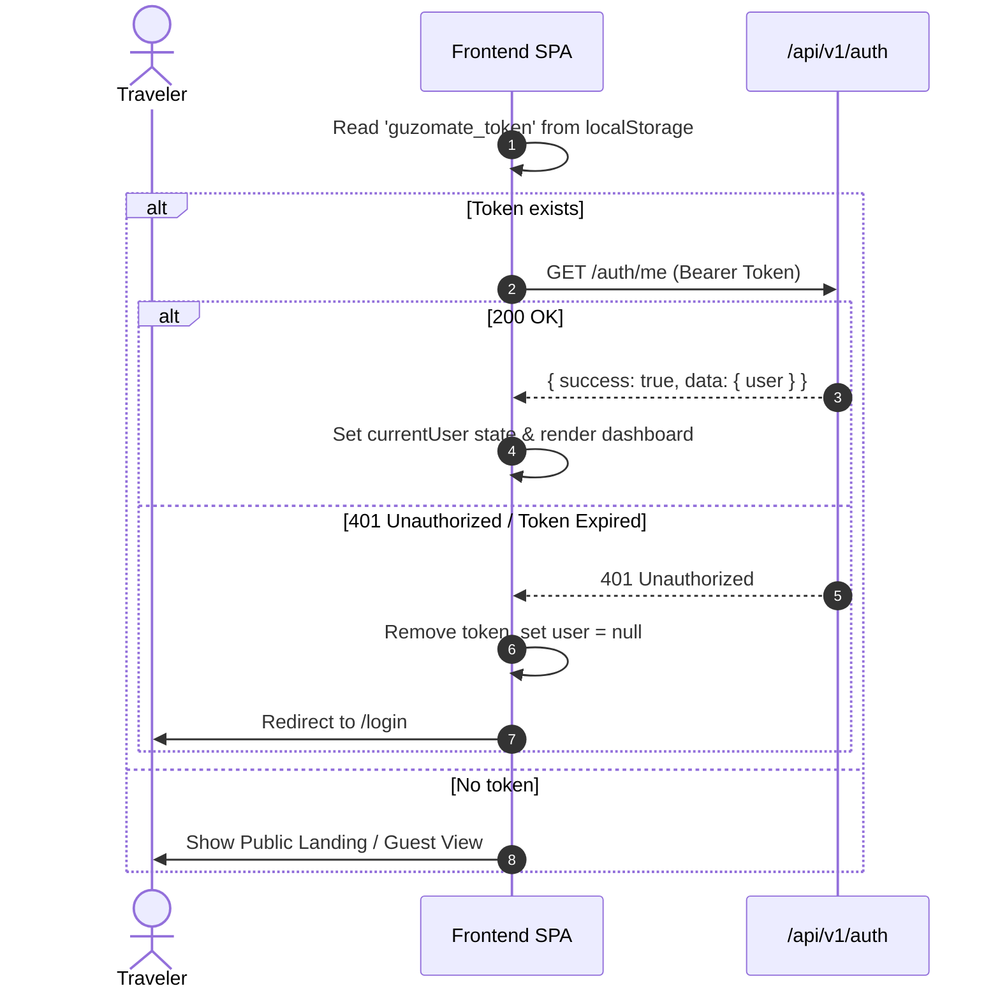

# GuzoMate Auth Module — Frontend Integration Guide 🔐

## 1. Overview & Architecture

The **Auth Module** handles user registration, authentication, credential validation, JWT token generation, and current session resolution (`/auth/me`).

- **Base URL:** `/api/v1/auth`
- **Authentication Scheme:** HTTP Bearer Token (`Authorization: Bearer <accessToken>`)
- **Default Expiration:** 7 days (`JWT_EXPIRES_IN=7d`)
- **Rate Limit:** 20 requests per 15-minute window per IP on `/login` and `/register`.

---

## 2. API Endpoints Reference

### 2.1 Register New Traveler Account

Creates a new traveler user account, automatically provisions default notification preferences (5 km radius, all types), and returns an access token along with the sanitized user record.

- **Endpoint:** `POST /api/v1/auth/register`
- **Auth Required:** No (Public)
- **Headers:** `Content-Type: application/json`
- **Rate Limit:** 20 requests / 15 minutes

#### Request Body
```json
{
  "email": "traveler@example.com",
  "password": "Password123",
  "name": "Abebe Bikila",
  "preferredLanguage": "am"
}
```

| Field | Type | Required | Description / Rules |
| :--- | :--- | :--- | :--- |
| `email` | `string` | **Yes** | Valid email address. Case-insensitive (normalized to lowercase). |
| `password` | `string` | **Yes** | Min 8 chars, must contain at least 1 letter (`[A-Za-z]`) and at least 1 digit (`[0-9]`). |
| `name` | `string` | No | Display name. Min 2 chars, max 100 chars. |
| `preferredLanguage` | `string` | No | One of: `"en"` (English), `"am"` (Amharic), `"om"` (Afaan Oromo). Defaults to `"en"`. |

#### Success Response (`201 Created`)
```json
{
  "success": true,
  "data": {
    "user": {
      "id": "e6a578bc-3212-4299-8cfb-665e729a8f21",
      "email": "traveler@example.com",
      "name": "Abebe Bikila",
      "role": "USER",
      "status": "ACTIVE",
      "preferredLanguage": "am",
      "createdAt": "2026-10-27T07:45:00.000Z",
      "updatedAt": "2026-10-27T07:45:00.000Z"
    },
    "accessToken": "eyJhbGciOiJIUzI1NiIsInR5cCI6IkpXVCJ9..."
  }
}
```

#### Error Responses
- **`400 Bad Request`** (`VALIDATION_ERROR`): Validation constraints failed (e.g., password does not have numbers).
  ```json
  {
    "success": false,
    "error": {
      "code": "VALIDATION_ERROR",
      "message": "Invalid request data",
      "details": [
        { "path": ["password"], "message": "Password must contain at least one number" }
      ]
    }
  }
  ```
- **`409 Conflict`** (`CONFLICT`): An account with this email already exists.
  ```json
  {
    "success": false,
    "error": {
      "code": "CONFLICT",
      "message": "A user with this email address already exists."
    }
  }
  ```
- **`429 Too Many Requests`** (`RATE_LIMIT_EXCEEDED`): Exceeded 20 attempts in 15 minutes.

---

### 2.2 User Login

Validates email and password, verifies account status, and issues a fresh JWT access token.

- **Endpoint:** `POST /api/v1/auth/login`
- **Auth Required:** No (Public)
- **Headers:** `Content-Type: application/json`
- **Rate Limit:** 20 requests / 15 minutes

#### Request Body
```json
{
  "email": "traveler@example.com",
  "password": "Password123"
}
```

| Field | Type | Required | Description |
| :--- | :--- | :--- | :--- |
| `email` | `string` | **Yes** | Valid email address. |
| `password` | `string` | **Yes** | Non-empty string. |

#### Success Response (`200 OK`)
```json
{
  "success": true,
  "data": {
    "user": {
      "id": "e6a578bc-3212-4299-8cfb-665e729a8f21",
      "email": "traveler@example.com",
      "name": "Abebe Bikila",
      "role": "USER",
      "status": "ACTIVE",
      "preferredLanguage": "am",
      "createdAt": "2026-10-27T07:45:00.000Z",
      "updatedAt": "2026-10-27T07:45:00.000Z"
    },
    "accessToken": "eyJhbGciOiJIUzI1NiIsInR5cCI6IkpXVCJ9..."
  }
}
```

#### Error Responses
- **`401 Unauthorized`** (`UNAUTHORIZED`): Invalid email or password.
  ```json
  {
    "success": false,
    "error": {
      "code": "UNAUTHORIZED",
      "message": "Invalid email or password."
    }
  }
  ```
- **`403 Forbidden`** (`FORBIDDEN`): The account is suspended by moderation.
  ```json
  {
    "success": false,
    "error": {
      "code": "FORBIDDEN",
      "message": "Your account has been suspended. Please contact moderation."
    }
  }
  ```
- **`429 Too Many Requests`** (`RATE_LIMIT_EXCEEDED`): Exceeded 20 attempts in 15 minutes.

---

### 2.3 Get Current Authenticated User (`/me`)

Retrieves the authenticated user profile using the JWT provided in the `Authorization` header. Ideal for app hydration / auth bootstrap on page refresh.

- **Endpoint:** `GET /api/v1/auth/me`
- **Auth Required:** Yes (`Bearer <accessToken>`)
- **Headers:** `Authorization: Bearer <accessToken>`

#### Success Response (`200 OK`)
```json
{
  "success": true,
  "data": {
    "user": {
      "id": "e6a578bc-3212-4299-8cfb-665e729a8f21",
      "email": "traveler@example.com",
      "name": "Abebe Bikila",
      "role": "USER",
      "status": "ACTIVE",
      "preferredLanguage": "am",
      "createdAt": "2026-10-27T07:45:00.000Z",
      "updatedAt": "2026-10-27T07:45:00.000Z"
    }
  }
}
```

#### Error Responses
- **`401 Unauthorized`** (`UNAUTHORIZED`): Missing header, invalid token, or expired token (`Token expired`).
- **`403 Forbidden`** (`FORBIDDEN`): Account has been suspended.

---

## 3. TypeScript Interfaces for Frontend

Copy and paste these definitions into your frontend types file (e.g. `src/types/auth.ts`):

```typescript
export type UserRole = 'USER' | 'MODERATOR' | 'ADMIN';
export type UserStatus = 'ACTIVE' | 'SUSPENDED';
export type SupportedLanguage = 'en' | 'am' | 'om';

export interface User {
  id: string;
  email: string;
  name: string | null;
  role: UserRole;
  status: UserStatus;
  preferredLanguage: SupportedLanguage;
  createdAt: string;
  updatedAt: string;
}

export interface RegisterPayload {
  email: string;
  password: string;
  name?: string;
  preferredLanguage?: SupportedLanguage;
}

export interface LoginPayload {
  email: string;
  password: string;
}

export interface AuthSuccessData {
  user: User;
  accessToken: string;
}

export interface ApiResponse<T> {
  success: boolean;
  data: T;
  meta?: {
    page?: number;
    limit?: number;
    total?: number;
    totalPages?: number;
  };
}

export interface ApiErrorResponse {
  success: false;
  error: {
    code: string;
    message: string;
    details?: Array<{
      path: (string | number)[];
      message: string;
    }>;
  };
}
```

---

## 4. Frontend Integration Patterns & Best Practices

### 4.1 Axios Client with Auto-Bearer Interceptor
```typescript
import axios from 'axios';

export const apiClient = axios.create({
  baseURL: import.meta.env.VITE_API_BASE_URL || '/api/v1',
  headers: {
    'Content-Type': 'application/json',
  },
});

// Inject Bearer token
apiClient.interceptors.request.use((config) => {
  const token = localStorage.getItem('guzomate_token');
  if (token) {
    config.headers.Authorization = `Bearer ${token}`;
  }
  return config;
});

// Handle Token Expiration
apiClient.interceptors.response.use(
  (response) => response,
  (error) => {
    if (error.response?.status === 401) {
      // Clear storage and redirect to login
      localStorage.removeItem('guzomate_token');
      localStorage.removeItem('guzomate_user');
      window.dispatchEvent(new Event('auth:logout'));
    }
    return Promise.reject(error);
  }
);
```

### 4.2 Auth State Hydration Flow (React / Next.js / Vue)



### 4.3 Form Validation Checklist for Frontend
- [ ] **Email:** Check format with standard regex before submission.
- [ ] **Password:** Must be $\ge 8$ chars, must have 1 letter and 1 number. Show inline password strength helper.
- [ ] **Language Selection:** Default to Amharic (`am`) or English (`en`) depending on browser locale.
- [ ] **Suspended Account:** Show explicit support prompt if code `FORBIDDEN` or message includes `suspended`.
- [ ] **Rate Limiting (429):** If `RATE_LIMIT_EXCEEDED` is returned, disable the submit button and show a countdown timer for 15 minutes.
