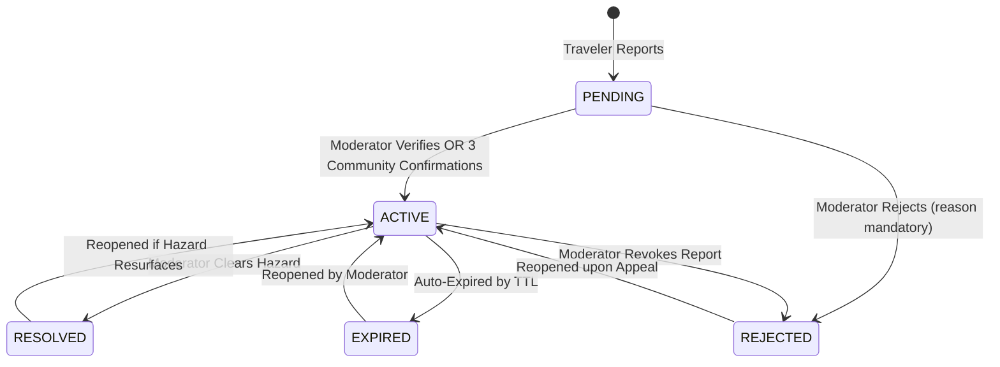

# GuzoMate Moderation Module — Frontend Integration Guide 🛡️

## 1. Overview & Architecture

The **Moderation Module** provides administrative review queues, incident status overrides, and audit trails for GuzoMate moderators and administrators. It allows staff to verify flagged/disputed reports, resolve cleared road hazards, and reject spam or inaccurate reports.

- **Base URL:** `/api/v1/moderation`
- **Access Control:** All endpoints require an `Authorization: Bearer <accessToken>` header from a user with role `MODERATOR` or `ADMIN`. Regular travelers (`USER`) receive `403 Forbidden`.

---

## 2. State Machine Transitions

Moderators can transition incidents according to this strict finite state machine:



> [!IMPORTANT]
> - Whenever a report is transitioned to `ACTIVE` by a moderator, the `verification` field is automatically set to **`MODERATOR_VERIFIED`**, and automated geo-push notifications are immediately triggered.
> - Whenever status is set to `REJECTED`, a non-empty `reason` string is **mandatory** for transparency.

---

## 3. Endpoints Reference

### 3.1 List Incidents for Moderation Queue

Retrieves a prioritized moderation review feed. Prioritizes heavily disputed incidents first (`orderBy: [{ disputesCount: 'desc' }, { createdAt: 'desc' }]`).

- **Endpoint:** `GET /api/v1/moderation/incidents`
- **Auth Required:** Yes (`MODERATOR` or `ADMIN`)
- **Query Parameters:**

| Parameter | Type | Default | Description |
| :--- | :--- | :--- | :--- |
| `disputedOnly` | `boolean` (`"true"` \| `"false"`) | `false` | When `"true"`, filters exclusively to incidents with $\ge 1$ dispute. |
| `status` | `IncidentStatus` | `PENDING,ACTIVE` | Filter by specific status. Defaults to actionable pending/active incidents. |
| `type` | `IncidentType` | — | Filter by incident type enum. |
| `severity` | `IncidentSeverity` | — | Filter by severity (`LOW`, `MEDIUM`, `HIGH`, `CRITICAL`). |
| `page` | `integer` | `1` | Page number ($\ge 1$). |
| `limit` | `integer` | `20` | Results per page (1 to 100). |

#### Success Response (`200 OK`)
```json
{
  "success": true,
  "data": {
    "items": [
      {
        "id": "c71e21b0-449e-4e4a-b5e1-8f5bc65181a9",
        "type": "ACCIDENT",
        "description": "Multi-car pileup near Bole Medhanialem roundabout blocking both lanes.",
        "severity": "CRITICAL",
        "status": "PENDING",
        "verification": "UNVERIFIED",
        "location": {
          "lat": 8.9954,
          "lon": 38.7845
        },
        "confirmationsCount": 1,
        "disputesCount": 4,
        "occurredAt": "2026-10-27T09:15:00.000Z",
        "expiresAt": "2026-10-27T13:15:00.000Z",
        "evidenceUrl": "https://example.com/photos/accident.jpg",
        "reporter": {
          "id": "7817cbfa-3ff9-49c0-9fbb-8d519b52a781",
          "email": "reporter@example.com",
          "name": "Chala D."
        },
        "createdAt": "2026-10-27T09:15:00.000Z",
        "updatedAt": "2026-10-27T09:30:00.000Z"
      }
    ]
  },
  "meta": {
    "page": 1,
    "limit": 20,
    "total": 1,
    "totalPages": 1
  }
}
```

---

### 3.2 Update Incident Status (Moderator Action)

Transitions an incident to a new status (e.g. `ACTIVE`, `RESOLVED`, `REJECTED`) and records the action in the audit trail.

- **Endpoint:** `PATCH /api/v1/moderation/incidents/:id/status`
- **Auth Required:** Yes (`MODERATOR` or `ADMIN`)
- **Headers:** `Content-Type: application/json`

#### Request Body
```json
{
  "status": "REJECTED",
  "reason": "Verified on CCTV: Road is completely clear; duplicate false report."
}
```

| Field | Type | Required | Notes |
| :--- | :--- | :--- | :--- |
| `status` | `IncidentStatus` | **Yes** | `"PENDING"`, `"ACTIVE"`, `"RESOLVED"`, `"REJECTED"`, or `"EXPIRED"`. |
| `reason` | `string` | **Required if status is REJECTED**; optional otherwise. | Max 500 characters. Recorded in audit log. |

#### Success Response (`200 OK`)
```json
{
  "success": true,
  "data": {
    "id": "c71e21b0-449e-4e4a-b5e1-8f5bc65181a9",
    "status": "REJECTED",
    "verification": "UNVERIFIED",
    "updatedAt": "2026-10-27T10:45:00.000Z"
  }
}
```

#### Error Response (Invalid Transition)
```json
{
  "success": false,
  "error": {
    "code": "BAD_REQUEST",
    "message": "Invalid incident status transition from REJECTED to RESOLVED."
  }
}
```

---

### 3.3 Get Incident Audit History

Fetches the complete audit timeline for a specific incident, showing who changed the status, why, and prior states.

- **Endpoint:** `GET /api/v1/moderation/incidents/:id/history`
- **Auth Required:** Yes (`MODERATOR` or `ADMIN`)

#### Success Response (`200 OK`)
```json
{
  "success": true,
  "data": {
    "incidentId": "c71e21b0-449e-4e4a-b5e1-8f5bc65181a9",
    "history": [
      {
        "id": "e4f3a1b2-...",
        "action": "MODERATION_STATUS_CHANGE",
        "reason": "Verified on CCTV: Road is clear.",
        "metadata": {
          "fromStatus": "PENDING",
          "toStatus": "REJECTED",
          "fromVerification": "UNVERIFIED",
          "toVerification": "UNVERIFIED"
        },
        "actor": {
          "id": "a1b2c3d4-...",
          "name": "Sarah Moderator",
          "role": "MODERATOR"
        },
        "createdAt": "2026-10-27T10:45:00.000Z"
      },
      {
        "id": "d1c2b3a4-...",
        "action": "INCIDENT_DISPUTE_FLAGGED",
        "reason": "Disputes reached threshold (3 disputes). Flagged for moderation review.",
        "metadata": {
          "confirmationsCount": 1,
          "disputesCount": 3
        },
        "actor": null,
        "createdAt": "2026-10-27T09:30:00.000Z"
      }
    ]
  }
}
```

---

## 4. TypeScript Interfaces for Frontend

```typescript
export interface ModerationIncidentItem {
  id: string;
  type: string;
  description: string;
  severity: 'LOW' | 'MEDIUM' | 'HIGH' | 'CRITICAL';
  status: 'PENDING' | 'ACTIVE' | 'RESOLVED' | 'REJECTED' | 'EXPIRED';
  verification: 'UNVERIFIED' | 'COMMUNITY_CONFIRMED' | 'MODERATOR_VERIFIED';
  location: {
    lat: number;
    lon: number;
  };
  confirmationsCount: number;
  disputesCount: number;
  occurredAt?: string;
  expiresAt?: string;
  evidenceUrl?: string | null;
  reporter?: {
    id: string;
    email: string;
    name: string | null;
  };
  createdAt: string;
  updatedAt: string;
}

export interface ModerationStatusPayload {
  status: 'PENDING' | 'ACTIVE' | 'RESOLVED' | 'REJECTED' | 'EXPIRED';
  reason?: string;
}

export interface AuditLogEntry {
  id: string;
  action: string;
  reason: string | null;
  metadata?: Record<string, any>;
  actor?: {
    id: string;
    name: string | null;
    role: string;
  } | null;
  createdAt: string;
}
```

---

## 5. Frontend UI Moderation Table Recipe

```tsx
import React, { useState } from 'react';
import { useMutation, useQueryClient } from '@tanstack/react-query';
import { apiClient } from '../lib/api-client';
import { ModerationIncidentItem } from '../types/moderation';

export const ModerationActionModal: React.FC<{
  incident: ModerationIncidentItem;
  onClose: () => void;
}> = ({ incident, onClose }) => {
  const queryClient = useQueryClient();
  const [targetStatus, setTargetStatus] = useState<string>('ACTIVE');
  const [reason, setReason] = useState<string>('');
  const [errorMsg, setErrorMsg] = useState<string | null>(null);

  const mutation = useMutation({
    mutationFn: async () => {
      await apiClient.patch(`/moderation/incidents/${incident.id}/status`, {
        status: targetStatus,
        reason: reason.trim() || undefined,
      });
    },
    onSuccess: () => {
      queryClient.invalidateQueries({ queryKey: ['moderation', 'incidents'] });
      onClose();
    },
    onError: (err: any) => {
      setErrorMsg(err.response?.data?.error?.message || 'Failed to update status.');
    },
  });

  const handleSubmit = (e: React.FormEvent) => {
    e.preventDefault();
    if (targetStatus === 'REJECTED' && !reason.trim()) {
      setErrorMsg('Please specify a rejection reason.');
      return;
    }
    mutation.mutate();
  };

  return (
    <div className="fixed inset-0 bg-black/50 flex items-center justify-center p-4 z-50">
      <form onSubmit={handleSubmit} className="bg-white rounded-xl max-w-md w-full p-6 space-y-4">
        <h3 className="text-lg font-bold">Review Incident #{incident.id.slice(0, 8)}</h3>
        <p className="text-sm text-gray-600">{incident.description}</p>
        
        {errorMsg && <div className="text-sm text-red-600 bg-red-50 p-2 rounded">{errorMsg}</div>}

        <div>
          <label className="block text-sm font-medium mb-1">Target Status</label>
          <select
            value={targetStatus}
            onChange={(e) => setTargetStatus(e.target.value)}
            className="w-full border rounded-lg p-2"
          >
            <option value="ACTIVE">Approve & Mark Active (MODERATOR_VERIFIED)</option>
            <option value="RESOLVED">Mark as Resolved</option>
            <option value="REJECTED">Reject / Revoke (Disputed/Spam)</option>
          </select>
        </div>

        <div>
          <label className="block text-sm font-medium mb-1">
            Reason {targetStatus === 'REJECTED' && <span className="text-red-500">*</span>}
          </label>
          <textarea
            value={reason}
            onChange={(e) => setReason(e.target.value)}
            placeholder="Audit log reason (mandatory for rejection)..."
            rows={3}
            className="w-full border rounded-lg p-2"
          />
        </div>

        <div className="flex justify-end space-x-2 pt-2">
          <button type="button" onClick={onClose} className="px-4 py-2 text-gray-600 hover:bg-gray-100 rounded-lg">
            Cancel
          </button>
          <button
            type="submit"
            disabled={mutation.isPending}
            className="px-4 py-2 bg-blue-600 text-white rounded-lg font-medium hover:bg-blue-700"
          >
            {mutation.isPending ? 'Saving...' : 'Apply Status'}
          </button>
        </div>
      </form>
    </div>
  );
};
```
